# Screens and components

Each entry: screenshot in `screenshots/`, runnable page in `standalone/<Name>.html` (open in a browser), source in `screens/<Name>/preview.html` (React code to port).

## Screens

### ClientDashboard

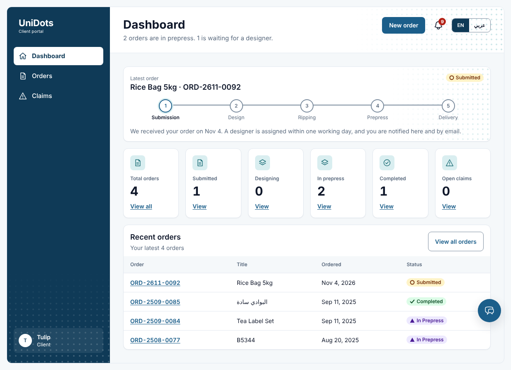

Client portal home. Sample data.

Client home. The welcome banner is replaced by the page title and a short KPI row where every tile links to its filtered list. Recent orders is a `DataTable` with the order link in the first column; the one primary action is New order. The floating `ChatFab` is the support chat entry point. Sample data.

### ClientNewClaim

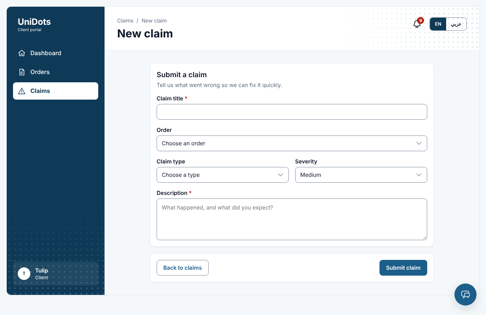

Client portal: submit a claim

Claim form. The select placeholders ("Choose an order") are the first option and must be invalid until changed, never saved as data. The only primary is Submit claim; Back to claims is secondary, in the action bar rather than a faint tinted link at the top.

### ClientNewOrder

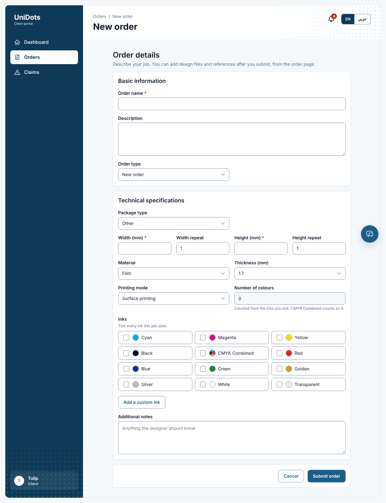

Client portal: new order form

New order form, shared with the employee Edit order screen through the same field set. Inks are `ColorOptions`: a real checkbox, a swatch and the ink name as text, so the label never sits on the colour. "Number of colours" is read-only and counted from the ticked inks (CMYK Combined counts as 4). Distortion and Job path are internal fields and are not offered to the client. Dimensions carry their unit (mm) in the label.

### ClientOrders

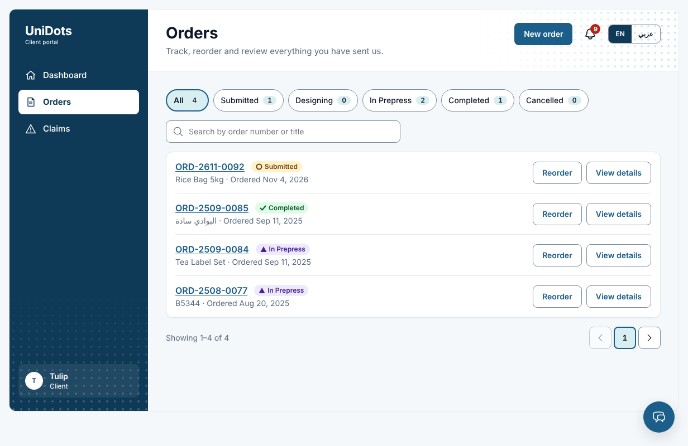

Client portal: my orders. Sample data.

Client order list. One chip row (status vocabulary, with counts), one search field, a single New order primary, and rows with Reorder and View details as secondary buttons (the row title is the link). Removed: the "Printing Order" line with a meaningless trend icon, and uppercase status pills. Sample data.

### ClientProfile

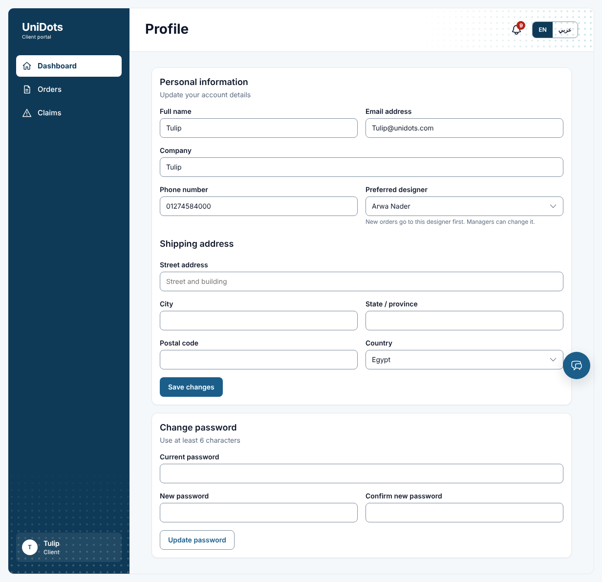

Client portal: profile and password

Profile in two cards. The title is "Profile" in the top bar (not "Client Portal" plus "Your Profile"). Save changes is the one primary; Update password is secondary because it is a separate, rarer task. Shipping fields are empty with neutral placeholders: never persist filler values like "a".

### ClientRegister

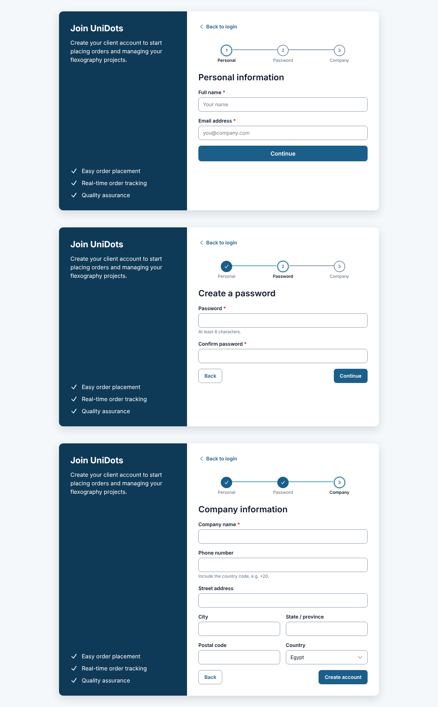

Auth: register, 3 steps

Client registration in three steps (Personal, Password, Company) inside `AuthLayout`: a `nav` panel with the promise and three benefits, and one task per step with the stepper above it. Each step has one primary button; Back is secondary. Placeholders are hints only, never examples that look like data (no "Tamer Ali", no "123 Main St"): labels carry the meaning. Country defaults to Egypt, not United States.

### CourierDelivery_Screen

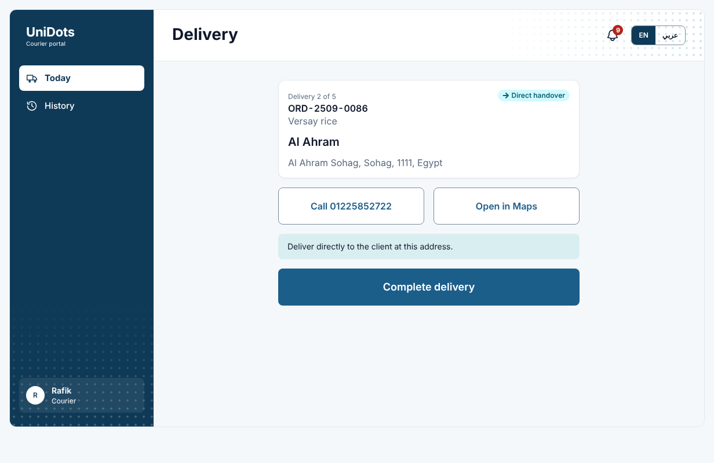

Courier: one delivery. Sample data.

One delivery per screen on a phone. The order, client and address come first; Call and Open in Maps are two large secondary buttons (64px); Complete delivery is the one full-width primary. The delivery method (Direct handover) is shown as a badge. Nothing else above the fold. Sample data.

### EmployeeDashboard

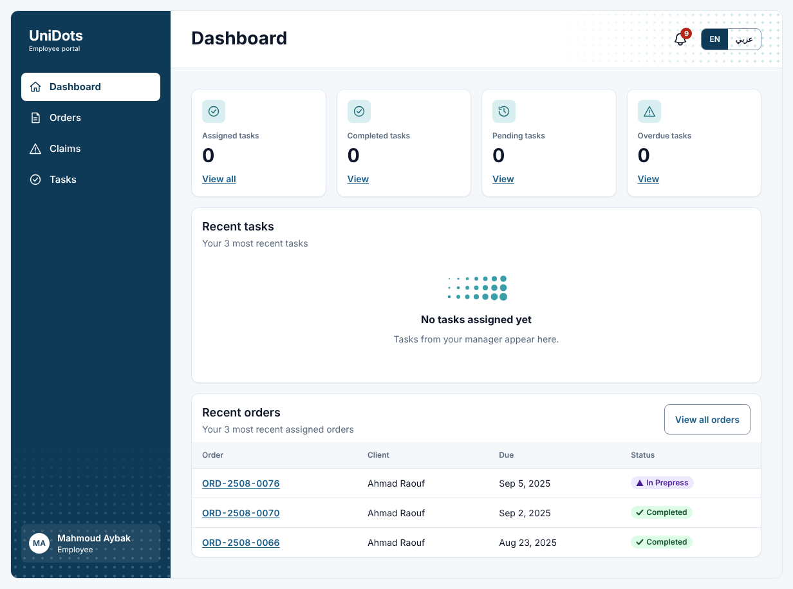

Employee portal home. Sample data.

Employee home: four task tiles (all zero here, shown with a real `EmptyState` instead of a blank table) and the assigned orders table. A welcome banner is not used. Sample data.

### EmployeeEditOrder

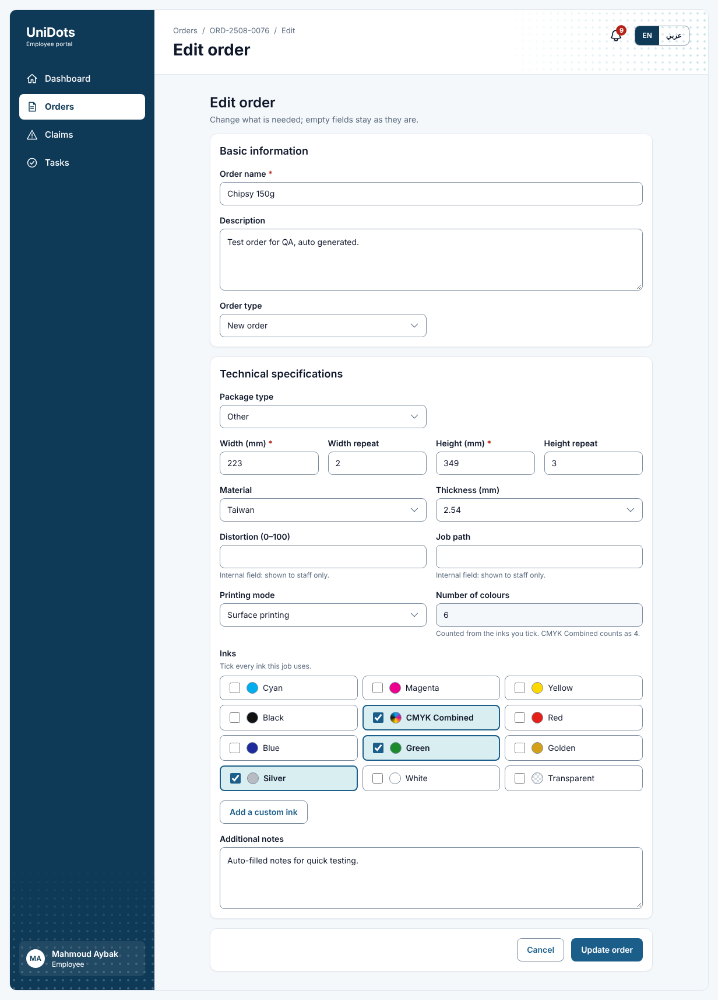

Employee: edit order form

Edit order uses the same form as the client New order, with the internal Distortion and Job path fields added for staff. Dimensions in mm, thickness in mm, ink picker as checkboxes with swatches.

### EmployeeOrderDetail

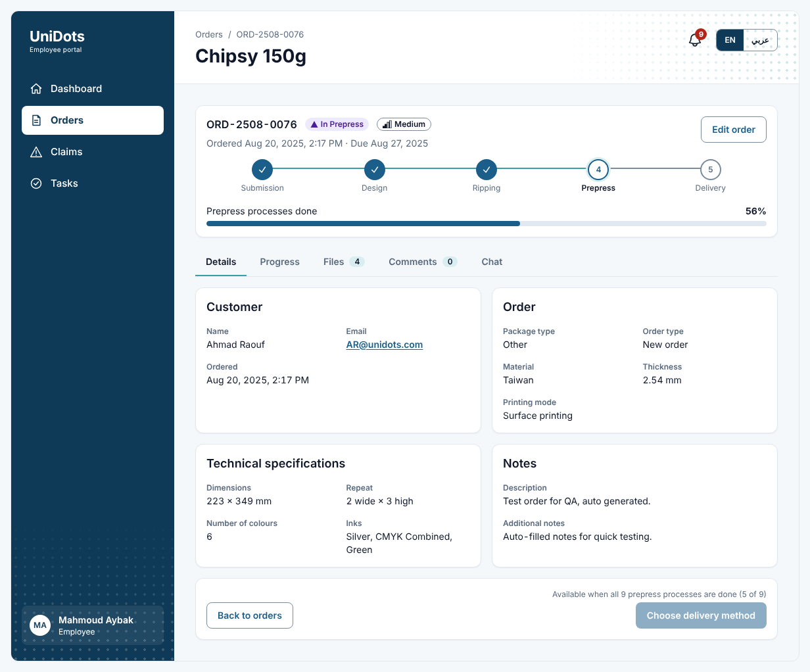

Employee: order details tab. Sample data.

Employee order detail. Same structure as the manager view: one header card (number, status, priority, five-stage stepper, prepress progress), tabs, `DefList` cards and an `ActionBar`. The primary, Choose delivery method, is disabled with a reason until all nine prepress processes are done, instead of showing a green button that cannot work yet. Units normalised to mm (the source mixed cm and microns): confirm. Sample data.

### EmployeeOrderFiles

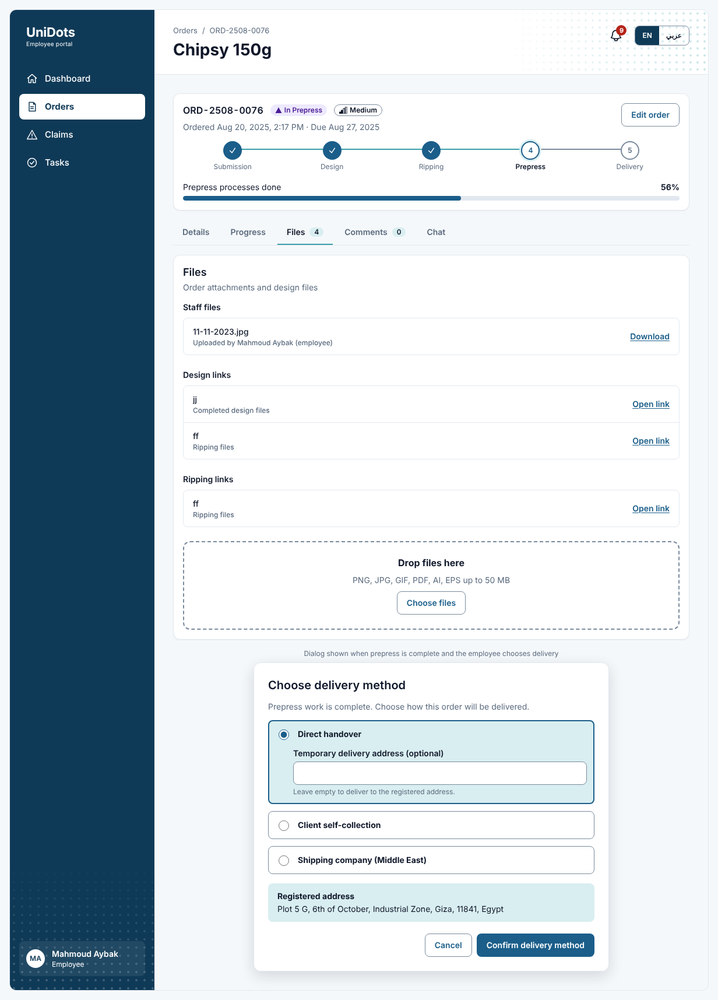

Employee: files tab and delivery dialog. Sample data.

Files tab as a `FileList` (staff files, design links, ripping links, each with a text action) plus the upload `Dropzone`. Below it, the Choose delivery method dialog: `RadioGroup` options with the optional temporary address only under the selected option, and the registered address as a `Notice`. Cancel and Confirm are secondary and primary.

### EmployeeOrderProgress

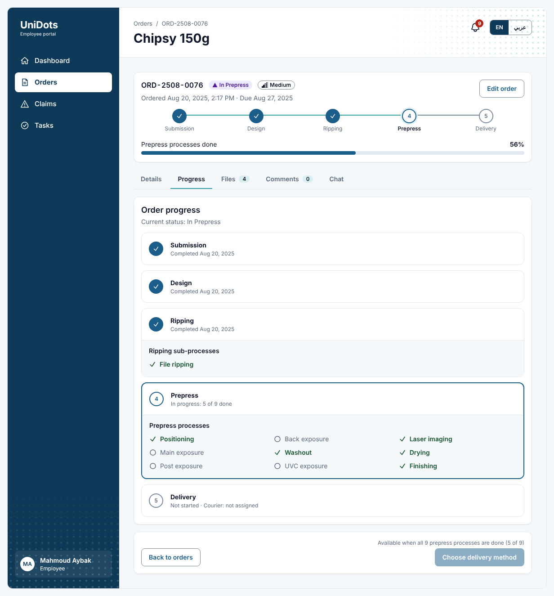

Employee: progress tab. Sample data.

Progress tab as one vertical `ProgressTimeline`: the same five stages as the header stepper (Submission, Design, Ripping, Prepress, Delivery), with the sub-processes inside Ripping and Prepress. Done sub-processes show a check and a screen-reader "(done)"; pending ones show an empty circle: green-versus-grey dots (colour alone) are gone. The header card already carries the stepper, so the old duplicate blue bar is dropped. The nine prepress processes are the real ones from the app.

### ManagerDashboard

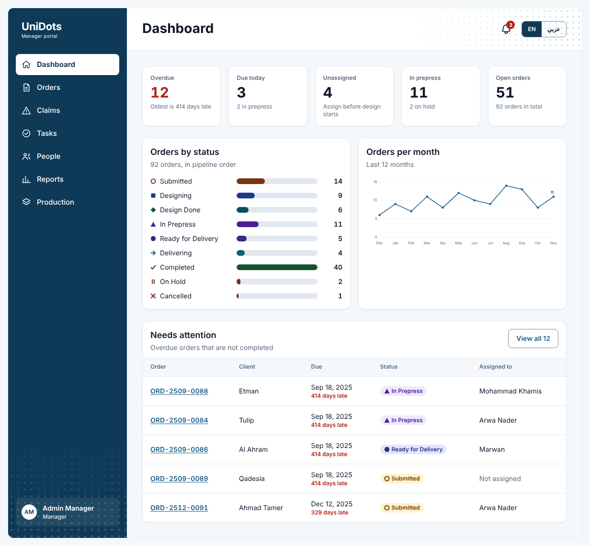

Manager home. Sample data.

Manager home. Five KPI tiles lead with what needs action (Overdue, Due today, Unassigned), then Orders by status (`StatusBars`) and Orders per month (`TrendChart`), then a Needs attention table. The page title appears once, in `TopBar`; there is no welcome banner. Sample data.

### OrderDetail

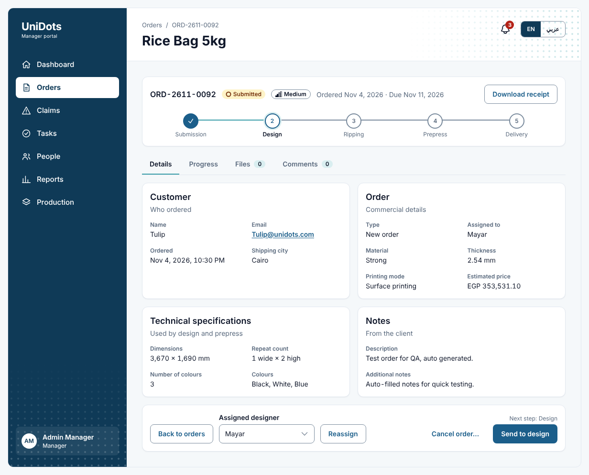

Order detail, Details tab. Sample data.

Order detail: header card with order number, status, priority and the five-stage `OrderStepper`; `Tabs` for Details, Progress, Files, Comments; `DefList` cards; and an `ActionBar` whose one primary is the next valid step. Money, sizes and units follow the formatting rules in the README. Sample data.

### OrdersList

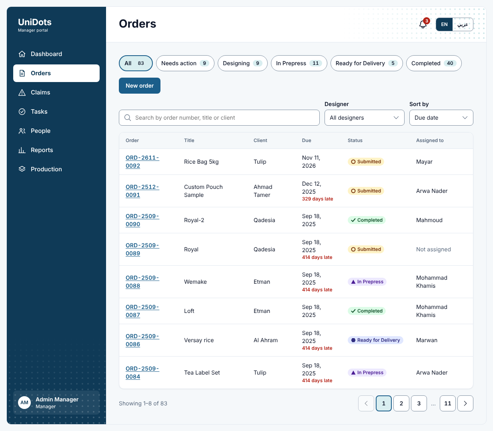

Orders list. Sample data.

Orders list: one chip row for status, one filter row (search, designer, sort), a `DataTable` with the record link in the first column, and a single `Pagination`. The only primary button is New order. Overdue orders show the days late under the due date. Sample data.

### PrepressHistory

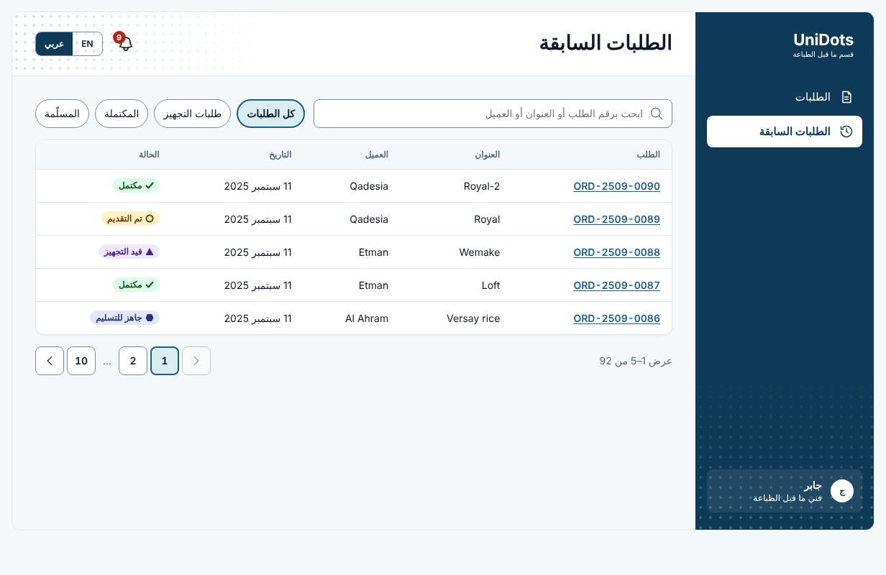

Prepress: order history. Sample data.

Order history for the prepress portal: one search, one filter chip row, a `DataTable` with the status as a translated `StatusBadge` (`label`), and one pagination summary. No View details button on every row: the order number is the link. The sample shows the date column once, as "Date", not "Completed" on orders that are not completed.

### PrepressOrderDetail

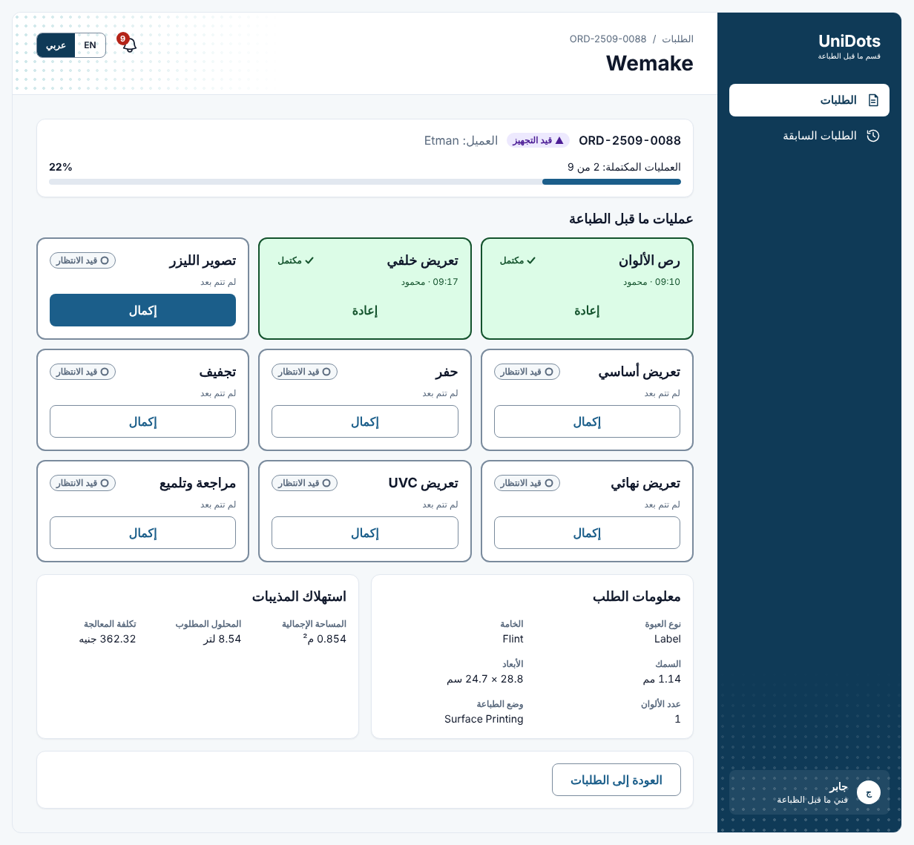

Prepress: order with 9 processes, Arabic RTL. Sample data.

The prepress floor screen: nine large process cards in a 3 × 3 grid, Arabic first. Each card shows the process, its state in words (مكتمل / قيد الانتظار), who and when, and one button. The first pending process gets the single primary button; other pending ones are secondary, finished ones are a quiet "إعادة" (redo). Cards are at least 56px of touch height. Order info and solvent use sit below, never above, the work. Replaces the old per-card pile of coloured chips (UVC / نهائي) and mixed English labels. Sample data.

### PrepressOrders

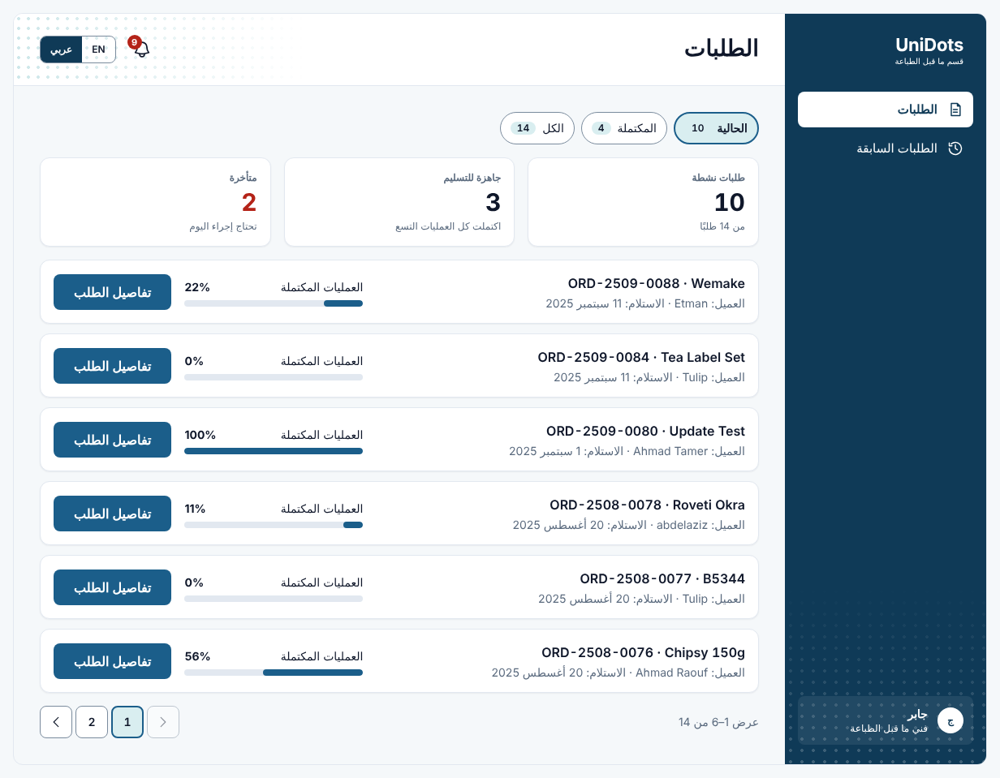

Prepress: active orders, Arabic RTL. Sample data.

Prepress order list for the floor operator, Arabic first (`dir="rtl"`). Each order is a large card with the order number and title, the client and date, a progress bar of finished processes (n of 9) and one button at control height 44px. The three tiles lead with what matters on the floor (active, ready for delivery, late). The top bar title is the only page title. Sample data.

## Mobile

### MobileClient

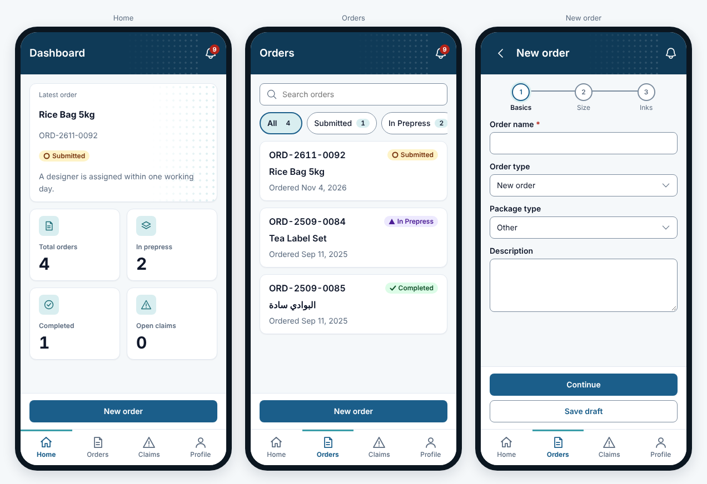

Client on a phone. Sample data.

Client phone screens: home with the latest order and four tiles, orders with search and chips, and the new order form split into three short steps (Basics, Size, Inks) so one thumb can finish it. New order is the single primary above the bottom tabs.

### MobileCourier

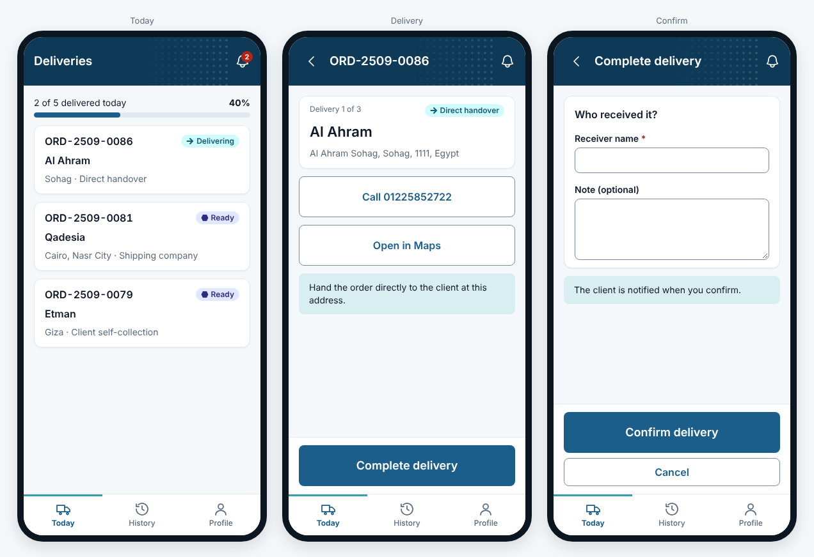

Courier on a phone: list, delivery, confirm. Sample data.

Courier phone flow: Today list, one delivery, confirm. Bottom tabs (Today, History, Profile) at 64px, one full-width primary above the tab bar, Call and Maps as 64px secondary buttons. Nothing scrolls sideways.

### MobileEmployee

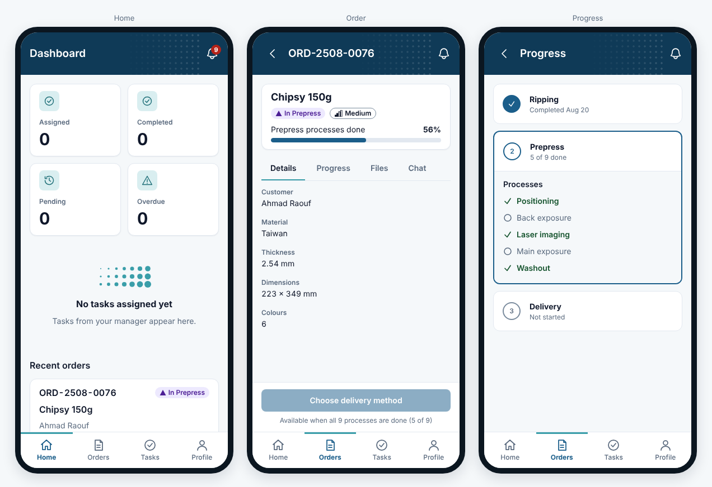

Employee on a phone. Sample data.

Employee phone screens: task tiles two across, an order with a disabled delivery action and the reason beside it, and progress as a compact timeline. Details are one-column `DefList` rows.

### MobileManager

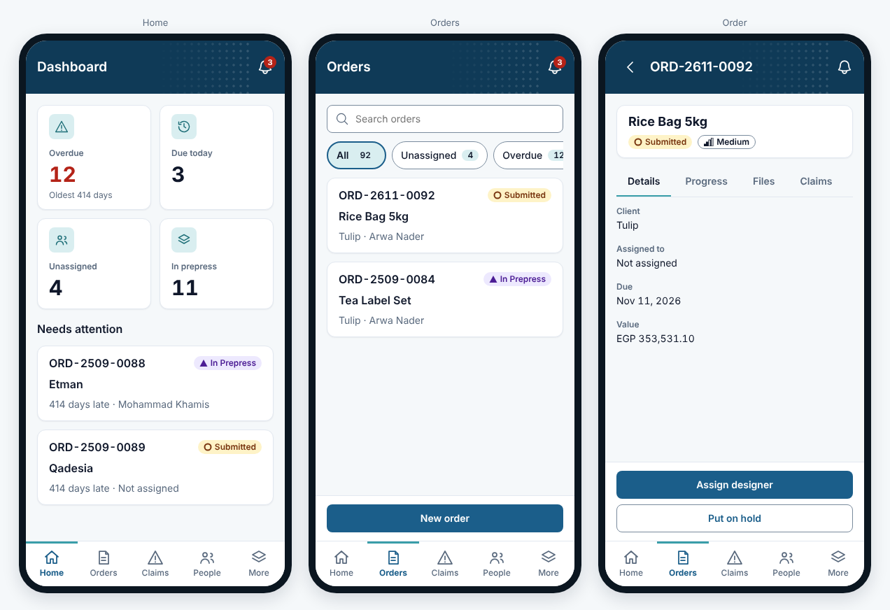

Manager on a phone. Sample data.

Manager phone screens: attention tiles and the overdue list, an orders list with filters, and order detail with Assign designer as the one primary and Put on hold secondary. Five bottom tabs; People and Production sit under More.

### MobilePrepress

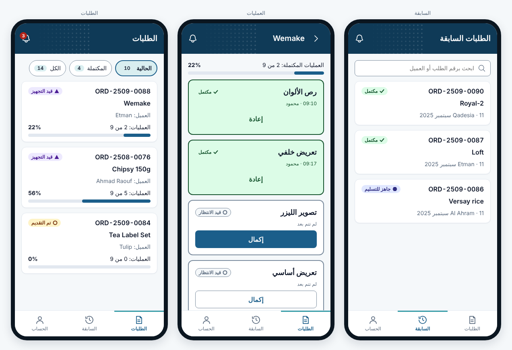

Prepress floor on a phone, Arabic RTL. Sample data.

Prepress phone screens in Arabic RTL: active orders with a progress bar of finished processes, one order's processes as a single column of large cards (the first pending one is the only primary), and history. The back chevron flips in RTL (`ud-flip`), tabs sit at the bottom.

## Components

### ActionBar (Actions)

The row of actions at the foot of a detail page. Props: children; add a `ud-spacer` span to push groups apart.

One primary: the next valid step for the current status (Submitted: `Send to design`), with a hint above it naming that step. Secondary actions (Back, Reassign) sit to the left; destructive actions are `ghost` text with an ellipsis (`Cancel order…`) and always open a `ConfirmDialog`. Never show steps that skip the pipeline.

### Avatar (Orders)

Initials in a circle. Props: `name`, `size`, `onNav`.

Fill is `primary` with `on-primary` (4.5:1 in both themes); on the navbar use `onNav` (`on-nav` fill, `nav` text). Always set the accessible name from `name`.

### Button (Actions)

A single action. Use one `primary` button per view; `secondary` for the alternative, `ghost` for low-emphasis actions, `danger` only inside a confirmation.

The consumer provides: a verb-first label (`Mark washout complete`, never `OK`), `onClick`, and `size="lg"` on prepress and courier screens (44px, `control-h-touch`).

Do: name the next step. Don't: put two primary buttons in one view, use colour alone to signal danger, or lower the height below `control-h`.

### Chips (Filters)

Quick filters for a list, shown as one row. Props: `items` (`{label, count}`), `active`, `label`.

A selected chip is `selected` with a 2px `primary` edge and bold text, never a solid primary fill: the one primary button on the page stays unique. Use one chip row per list; a second filter dimension goes into a `Select`. Chip labels reuse the status vocabulary exactly (`In Prepress`, not `Pending`).

### ConfirmDialog (Feedback)

The confirmation pattern for destructive actions. Props: `title` (a question naming the object), children (the consequence), `cancelLabel`, `confirmLabel`, `destructive`.

The safe choice sits first, the destructive one is the `danger` button and is labelled with the verb (`Cancel order`), never `Yes`. The consumer provides the overlay, focus trap and Escape handling.

### CourierDelivery (Courier)

One screen per delivery for the courier on a phone. Props: `orderLabel`, `client`, `address`, `callLabel`, `mapLabel`, `confirmLabel`.

Call and Map are `secondary` large buttons at `tap-courier` (64px); Confirm delivery is the single full-width `primary`. Add nothing else above the fold.

### Cover (Components)

### DataTable (Data)

The list table. Props: `columns` (`{key, label, num}`), `rows` (objects keyed by column; cell values are nodes) and `caption`.

The first column is a row header: put the record link there (`ud-link`, underlined). Column headings are sentence case, 12px `text-muted` on `bg-app`; numbers (`num`) right-align in tabular figures. Show status through `StatusBadge`, priority through `PriorityBadge`, lateness as `ud-late` text under the date. Rows highlight with `selected` on hover. No per-row solid buttons: the row link is the action. Put the table in a `ud-card pad0` and pair it with `Pagination`.

### DefList (Data)

Label and value pairs in a grid. Props: `items` (`[label, value]`), `cols`.

Replaces zebra-striped two-column tables on detail pages. Labels are 12px `text-muted` semibold; values 14px in tabular figures. Format values: money with the currency code and thousands separators (`EGP 353,531.10`), sizes in mm, volume in L, areas in m².

### Dropzone (Forms)

The artwork upload area with a file list. Props: `files` (`{ext, name, size}`), `title`, `hint`, `browse`.

The dashed edge is `border-control`. The component draws a file-type tile as a placeholder; the consumer supplies real thumbnails and progress. Always keep the Choose files button so keyboard and touch users can upload without dragging.

### EmptyState (Feedback)

A calm empty or zero state with the halftone motif. Props: `title`, children (one sentence), `action` (a `Button`).

Every empty state names what will appear and offers one action. Dots are `accent` and sit above the text, never behind data. Use for "No comments yet", an empty client list, and filters that match nothing. Don't use for loading.

### Field (Forms)

A labelled text input with optional hint and inline error. Props: `label` (always visible: never a placeholder), `hint`, `error`, `value`, `type`, `dir`.

The border is `border-control` (3:1); an invalid field gets a 2px `danger` border and an `alert` message beneath it that says what to do, not who was wrong. Pass `dir="rtl"` for Arabic.

### FormDialog (Feedback)

A modal form with a two-column field grid. Props: `title`, `description`, `cancelLabel`, `submitLabel`, children (`Field`, `Select`; add `className="ud-wide"` to a wrapper for a full-width row).

The submit is the only primary; Cancel is secondary. Name the submit with the verb and object (`Create employee`). The consumer provides the overlay, focus trap, Escape, and `autocomplete="off"` or `new-password` on credential fields so the browser never pre-fills the manager's own details. A form field must match its list: never offer a department or role the list can't show.

### KpiTile (Dashboards)

A single metric tile for the manager dashboard. Props: `label`, `value` (tabular figures), `note`.

Group four to six tiles in a row above charts. Chart series use `brand-700`, `brand-500` and `teal-500`, with direct labels, never colour alone.

### OrderCard (Orders)

A card summarising one order: tabular order number, title, `StatusBadge` and a row of label/value facts. Props: `number`, `title`, `status`, `statusLabel`, `meta` (array of `[label, value]`) and children for actions or a stepper.

Use it in the Client portal list and the manager overview; use a dense table row for the Employee portal. Don't put dot-motif artwork behind it.

### OrderStepper (Orders)

The five-stage progress line: Submission, Design, Ripping, Prepress, Delivery. Props: `current` (zero-based index), `steps` (translated labels) and `label` (the accessible name).

Done steps show a check, the current step is outlined with `primary`, later steps are muted. The connecting line fills with `accent`. The component mirrors in RTL through `dir`. Don't add or reorder stages per portal.

### Pagination (Data)

Page controls plus one summary. Props: `summary`, `page`, `items` (numbers and `…`), `prevLabel`, `nextLabel`.

State the range once ("Showing 1–10 of 83"), not above and below the list. The current page is `selected` with a 2px `primary` edge. Buttons are `control-h` (40px); mirrors in RTL (the prev/next arrows swap).

### PlateCanvas (Production)

A scaled layout of a plate with placed jobs. Props: `width`, `height` (mm), `margin` (mm), `placements` (`{x, y, w, h, label}` in mm), `caption`, `maxPx`.

The plate edge is `border-control`, the dashed line is the usable margin, jobs are `selected` with a `primary` edge and carry the order number and size as text. Always caption with plate id, size in mm, thickness in mm and material; never leave "Thickness: µm" blank. Units are mm throughout.

### PrepressChecklist (Prepress)

Large tappable process rows for the shop floor. Props: `items` (`{label, done, at, by}`), `solvent` and `solventLabel` for the readout, `pendingLabel`.

Each row is at least 56px (`checklist-row`) with a 32px checkbox; a done row turns `status-completed-bg` and shows the time and who completed it. The nine process names are the consumer's: the preview shows illustrative steps. Arabic first: pass `dir="rtl"` and translated labels.

### PriorityBadge (Orders)

Priority as an outline badge with a four-bar strength glyph and the word. Props: `level` (`low`, `medium`, `high`, `urgent`), `label`.

Outline, not filled, so it never competes with `StatusBadge`; `urgent` uses `danger` for the edge and text. Show priority only when it varies: a column that says Medium on every row should be hidden.

### Progress (Data)

A single-value progress bar with an optional label. Props: `value` (0–100), `label`.

`primary` on a `border` track, the value is also written as text. Use for used plate area or tank use, not for the order pipeline (that is `OrderStepper`).

### SearchField (Filters)

A search input with a leading magnifier. Props: `placeholder`, `label` (accessible name when no visible label).

The icon is 20px `text-muted`; the input keeps the `control-h` height and `border-control` edge. Put it first in the filter row and let it grow; say what it searches in the placeholder ("Search by order number, title or client").

### Select (Forms)

A native select with a drawn chevron, so the caret never clips (unlike the `10 per page` select). Props: `label`, `options` (strings), `value`, `hint`.

Native keeps keyboard, screen-reader and mobile behaviour. Always give a visible label above it; use it for fewer than about 12 options, and for dates use the native date input inside the same `Field` layout.

### StatusBadge (Orders)

The order status as a pill: colour, a distinct shape and the status text, never colour alone. Props: `status` (`submitted`, `designing`, `design-done`, `in-prepress`, `ready`, `delivering`, `completed`, `on-hold`, `cancelled`) and an optional `label` for the Arabic text.

Each status uses its own `status-<name>-bg` and `status-<name>-fg` pair (4.5:1 in both themes). Blue, indigo and violet statuses sit close in hue; the shape and the text tell them apart.

Do: translate through `label`. Don't: recolour a badge, shorten the status name, or show only the dot.

### StatusBars (Data)

Horizontal bars for a status distribution in pipeline order. Props: `items` (`{status, count, label}`), `label`.

Use this instead of a pie chart. Each row shows the status shape, its name and its count; the bar fill is `status-<name>-fg`, which differs in lightness as well as hue. Never rely on bar colour alone: the label is always on the row.

### Tabs (Navigation)

Section switcher inside one page (Details, Progress, Files, Comments). Props: `tabs` (strings or `{label, count}`), `active`, `label`.

The active tab is `text` with a 3px `accent` underline; the others are `text-muted`. Counts are optional and only shown when a count is meaningful (0 files is shown, a bare 0 comments is not needed). Never use tabs to switch the whole page: that is `TopBar` navigation.

### TankGauge (Production)

Fill level of the acid solution tank. Props: `title`, `percent`, `liters`, `capacity`, `statusLabel`, `lowAt` (default 20).

Fill is `brand-500`, switching to `danger` below `lowAt`, and the status badge always says the state in words (`Level OK`, `Low: order barrels`). Show the volume once, in litres with a thousands separator (`1,200 L`). Recycling efficiency is entered and shown as a percentage, not a 0–1 ratio.

### Toast (Feedback)

A transient message in three tones: `success`, `error`, `info`. Props: `tone`, `title`, children for one sentence.

Each tone pairs a shape with text and uses the matching status colours. Errors use `role="alert"` and stay until dismissed. Never use `alert()`.

### TopBar (Navigation)

The shared app shell header: wordmark, role-aware nav, notification bell, EN | عربي toggle, then page title and breadcrumb. Props: `nav`, `active`, `notifications`, `lang`, `title`, `crumbs`, `dir`.

One layout serves all five portals; only `nav` changes. The active item has a 3px `accent` underline. Keep the nav in one language: pass translated labels together.

### TrendChart (Data)

A line chart with a true zero baseline and real tick marks. Props: `points` (`{label, value}`), `label`, `emptyText`.

Straight segments between points (no smoothing: a spline invents values). The y-axis runs from 0 to a rounded top, drawn from the data, so a 0–1 axis cannot occur. The line is `primary`, gridlines `border`, labels 12px `text-muted`, the latest value is labelled. If every value is zero it renders `emptyText` instead of a flat line.

